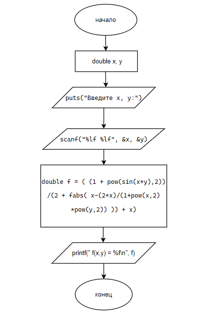

# Домашнее задание к lab5
### вариант 26
### Решение

``
#define _CRT_SECURE_NO_DEPRECATE
#include <locale.h>
#include <stdio.h>

#include <math.h>
int main() 
{
	double x, y;
	setlocale(LC_ALL, "ru_RU.UTF-8");
	puts("Введите x, y:");
	scanf("%lf %lf", &x, &y);
	double f = ( (1 + pow(sin(x+y),2))/(2 + fabs( x-(2*x)/(1+pow(x,2)*pow(y,2)) )) + x);
	printf("f(x,y) = %f\n", f);
}
``

### Блок схема 

### Вывод
Программа реализует вычисление математического выражения F(x, y). На вход подаются значения x и y, на выходе — вычисленное значение функции.
